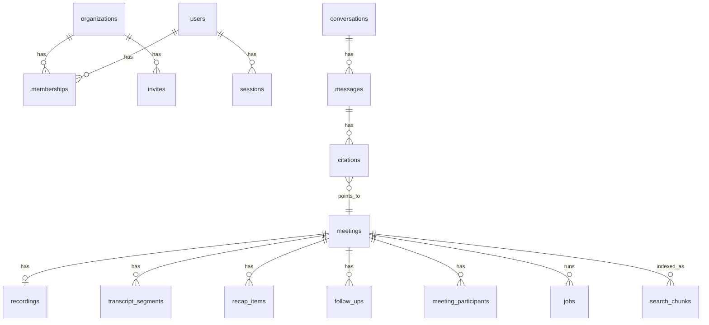

# Recapz data model (T31)

Status: **Proposal** for review. PostgreSQL, one `public` schema for identity and one
`org_<id>` schema per organization (see `03-architecture.md` section 3). Covers the MVP
plus the tables the next phases clearly need; tables marked *(later)* are not created in
the first migration.

Conventions: `id` is `uuid` (default `gen_random_uuid()`), every table has `created_at`
and `updated_at` (`timestamptz`), times inside a recording are integer milliseconds from
the start (`*_ms`), enums are `text` with a `CHECK` constraint.

## 1. ERD

## 2. Schema `public`

### organizations
| Column | Type | Notes |
|---|---|---|
| id | uuid PK | |
| name | text not null | |
| schema_name | text unique not null | `org_<short id>` |

### users
| Column | Type | Notes |
|---|---|---|
| id | uuid PK | |
| email | citext unique not null | Google account email |
| name | text not null | |
| google_sub | text unique | Google subject id, set on first sign-in |
| last_sign_in_at | timestamptz | |

### memberships
| Column | Type | Notes |
|---|---|---|
| organization_id | uuid FK organizations | PK part |
| user_id | uuid FK users | PK part |
| role | text | `owner`, `member` |

### invites
| Column | Type | Notes |
|---|---|---|
| id | uuid PK | |
| organization_id | uuid FK organizations | |
| email | citext not null | unique per organization while pending |
| role | text | `owner`, `member` |
| invited_by | uuid FK users | |
| expires_at | timestamptz not null | |
| accepted_at | timestamptz | null while pending |
| revoked_at | timestamptz | |

### sessions
| Column | Type | Notes |
|---|---|---|
| id | text PK | random token hash, cookie holds the token |
| user_id | uuid FK users | |
| organization_id | uuid FK organizations | active organization |
| user_agent | text | shown as device in Admin later |
| expires_at | timestamptz not null | |
| revoked_at | timestamptz | |

## 3. Schema `org_<id>` (one per organization)

### meetings
| Column | Type | Notes |
|---|---|---|
| id | uuid PK | |
| title | text not null | file name without extension by default |
| source | text | `upload`, `bot`, `desktop` |
| platform | text | `file`, `meet`, `zoom`, `teams`, `desktop` |
| language | text | `en`, `vi` |
| status | text | `processing`, `ready`, `incomplete` |
| stage | text | `uploading`, `transcribing`, `summarizing`, `filing` |
| error | text | reason shown when incomplete |
| started_at | timestamptz | meeting start (upload time for files) |
| duration_ms | integer | set after decode |
| owner_id | uuid | user id from `public.users` |
| summary | text | editable |
| summary_edited_at | timestamptz | |
| folder_id | uuid | *(later)* FK folders |
| deleted_at | timestamptz | soft delete before the cleanup job |

Index: `(status, started_at desc)`, trigram or full-text on `title` for search.

### recordings
| Column | Type | Notes |
|---|---|---|
| id | uuid PK | |
| meeting_id | uuid FK meetings unique | |
| original_path | text | storage key of the uploaded file |
| audio_path | text | normalized audio |
| mime_type | text | |
| size_bytes | bigint | |
| expires_at | timestamptz | retention |

### meeting_participants
| Column | Type | Notes |
|---|---|---|
| id | uuid PK | |
| meeting_id | uuid FK meetings | |
| speaker_label | text | label from diarization, for example `speaker_0` |
| display_name | text | name shown in the UI, editable |
| user_id | uuid | set when matched to a member |
| attended | boolean | *(later)* from calendar or bot |

### transcript_segments
| Column | Type | Notes |
|---|---|---|
| id | uuid PK | |
| meeting_id | uuid FK meetings | |
| seq | integer | order in the meeting, unique per meeting |
| start_ms | integer | |
| end_ms | integer | |
| participant_id | uuid FK meeting_participants | |
| text | text not null | |
| text_vi | text | *(later)* translation for interpreted meetings |

Index: `(meeting_id, start_ms)`; GIN full-text index on `text` for transcript search.

### recap_items
One table for the recap lists that share the same shape.

| Column | Type | Notes |
|---|---|---|
| id | uuid PK | |
| meeting_id | uuid FK meetings | |
| kind | text | `key_point`, `chapter`, `highlight`, `question` |
| seq | integer | display order |
| at_ms | integer | must fall inside the meeting |
| title | text | key points and chapters |
| text | text | |

### follow_ups
| Column | Type | Notes |
|---|---|---|
| id | uuid PK | |
| meeting_id | uuid FK meetings | |
| text | text not null | |
| owner_name | text | as said in the meeting |
| owner_user_id | uuid | matched member, nullable |
| at_ms | integer | |
| state | text | `open`, `done` |
| origin | text | `recap` (MVP), `suggested` *(later)* |
| suggestion_state | text | *(later)* `new`, `acknowledged`, `ignored` |
| done_at | timestamptz | |

Index: `(owner_user_id, state)`.

### search_chunks
| Column | Type | Notes |
|---|---|---|
| id | uuid PK | |
| meeting_id | uuid FK meetings | |
| start_ms | integer | |
| end_ms | integer | |
| text | text | joined segments with speaker names |
| tsv | tsvector | generated from text |
| embedding | vector(n) | dimension set by the embedding provider |

Index: GIN on `tsv`, HNSW on `embedding`.

### conversations, messages, citations
| Table | Columns |
|---|---|
| conversations | id, user_id, scope_meeting_id (null for all meetings), title |
| messages | id, conversation_id, role (`user`, `assistant`), text, status (`streaming`, `done`, `failed`) |
| citations | id, message_id, meeting_id, chunk_id, at_ms, seq |

### jobs
| Column | Type | Notes |
|---|---|---|
| id | uuid PK | |
| meeting_id | uuid FK meetings | nullable for non-meeting jobs |
| kind | text | `decode`, `transcribe`, `recap`, `index`, `cleanup` |
| state | text | `queued`, `running`, `succeeded`, `failed` |
| attempts | integer | |
| run_after | timestamptz | backoff |
| last_error | text | |
| locked_by | text | worker id |
| locked_at | timestamptz | |

Index: `(state, run_after)`. Unique `(meeting_id, kind)` among active jobs keeps a stage
from running twice.

### usage_events
| Column | Type | Notes |
|---|---|---|
| id | uuid PK | |
| meeting_id | uuid | nullable |
| function | text | `stt_batch`, `llm`, `embedding`, ... |
| provider | text | |
| units | numeric | seconds of audio or tokens |
| unit_kind | text | `audio_seconds`, `input_tokens`, `output_tokens` |

### audit_log *(later)*
id, actor_user_id, action, target, details (jsonb).

### Later phases
folders, calendar_connections (encrypted refresh token), calendar_events, bot_sessions,
documents, integrations, shares. They are designed in the task that needs them.

## 4. Rules enforced by the database

- `transcript_segments.start_ms <= end_ms`, `at_ms >= 0` (upper bound checked in code
  against `meetings.duration_ms`).
- `ON DELETE CASCADE` from meetings to every child table.
- Unique `(meeting_id, seq)` on segments and recap items so a retried stage replaces
  rows instead of duplicating them (delete then insert in one transaction).
