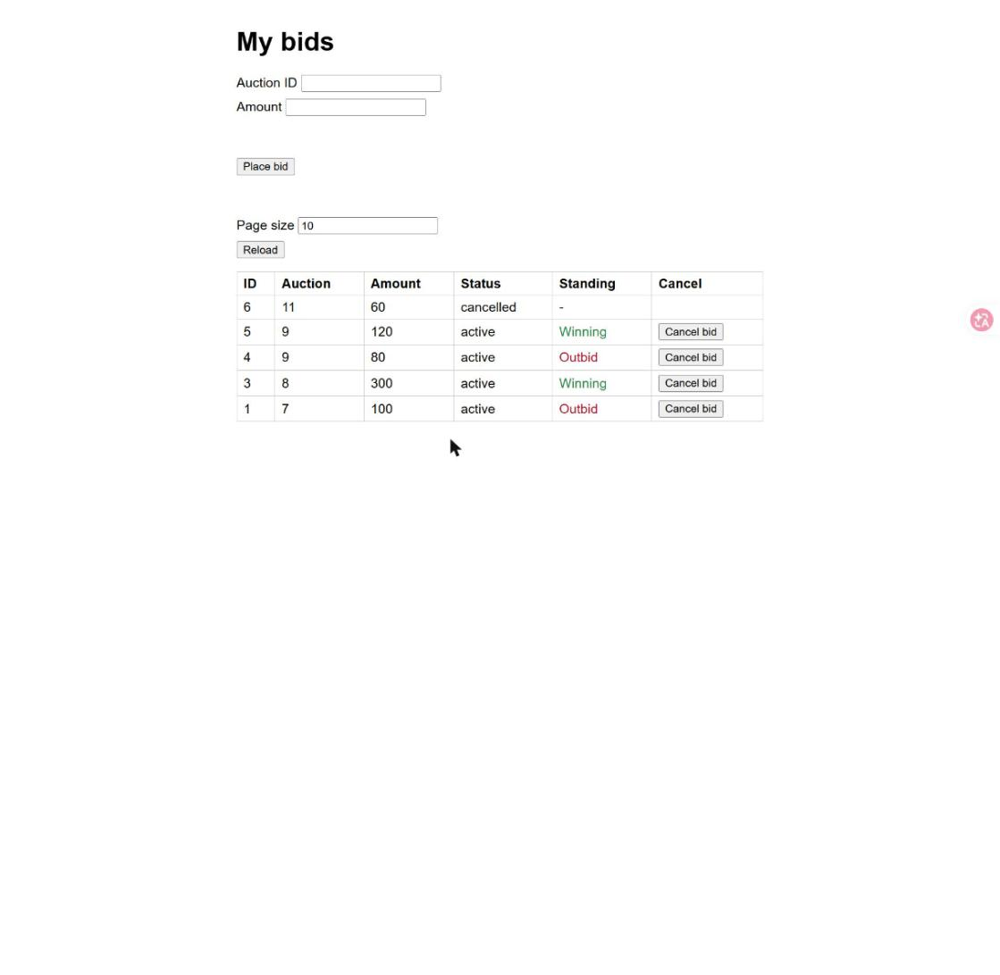
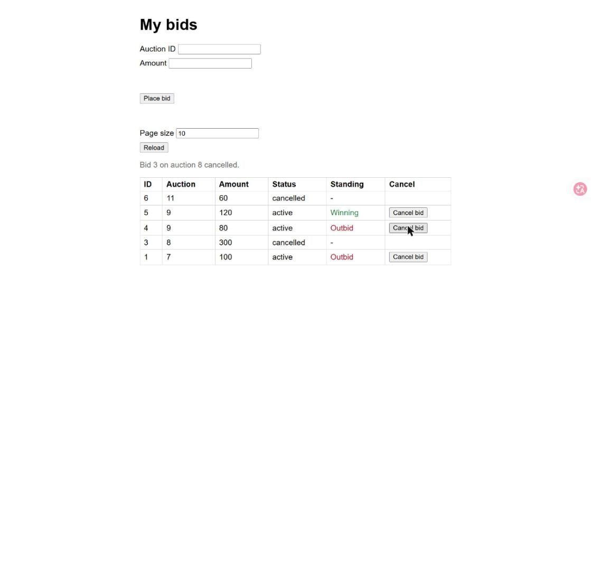
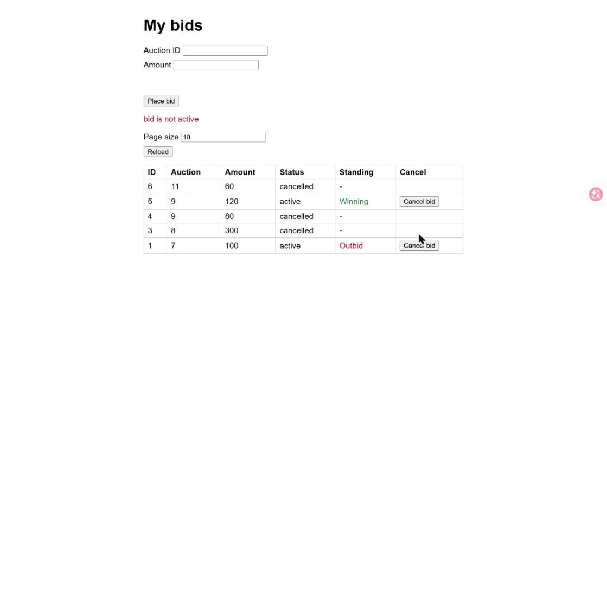

# Evidence: T-01 Cancel a recent bid from My bids

Captured by Claude with the Claude in Chrome tools: demo app
`python .claude/skills/evidence/seed_server.py 8010`, driven in Chrome (real clicks,
screenshots saved by the tool). Nothing was collected by hand. The server was stopped and the
tab closed afterwards. No report page was published; this folder is the record.

## Steps, in order

1. Opened http://127.0.0.1:8010/, cleared localStorage, set the page size to 10 and reloaded.
2. Clicked `Cancel bid` on bid 3 (auction 8, amount 300, Winning).
3. In the same tab, cancelled bid 4 through `fetch` (this plays "cancelled in another tab"),
   then clicked its `Cancel bid` button, which was still on the page.

## Screenshots

1. The new `Cancel` column: a `Cancel bid` button on every active row, none on the cancelled row 6.

   

2. After the click on bid 3 (dialog `Cancel bid 3 on auction 8 (amount 300)? This cannot be undone.`):
   notice `Bid 3 on auction 8 cancelled.`, row 3 shows `cancelled` and `-`, no button.

   

3. Bid 4 was already cancelled: red line `bid is not active`, the list was reloaded first, so row 4
   shows `cancelled` and `-`, and the cancel notice is empty.

   

## Files

| File | Step | Shows | Matrix |
|---|---|---|---|
| `01-cancel-column.jpg` | Page size 10, Reload | `Cancel` column, button only on active rows | M-004 |
| `02-cancel-accepted.jpg` | Click `Cancel bid` on bid 3, accept | Notice, row `cancelled`, standing `-`, no button | M-003, M-001 |
| `03-already-cancelled-error.jpg` | Click `Cancel bid` on bid 4 after a cancel elsewhere | Red `bid is not active` after the reload | M-008, M-056 |
| `tests.txt` | `run_tests.py --save` | 237 tests OK, including `test_cancel.py`, `test_cancel_api.py`, `test_cancel_page.py` | M-001 to M-017, M-056, M-057 |

## Limits

- The browser confirm dialog blocks the Chrome tools, so the run replaced `window.confirm` with a
  function that records its text and answers yes. The dialog text came out as specified, but a real
  dialog and the dismiss path (M-005) were not driven in the browser; the Node tests cover them.
- The web UI has one fixed user (42); the bids are seeded by the script. Bid 4 was cancelled
  through `fetch` in the same tab to play a second tab.
- T-01 builds no age check: the seeded bids are from 2023 and still cancel. The 5 minute window is T-02.
- Not shown here: clearing the stored standing, the hint refresh and the banner (T-04) and the
  effect on the auction price (T-03).
