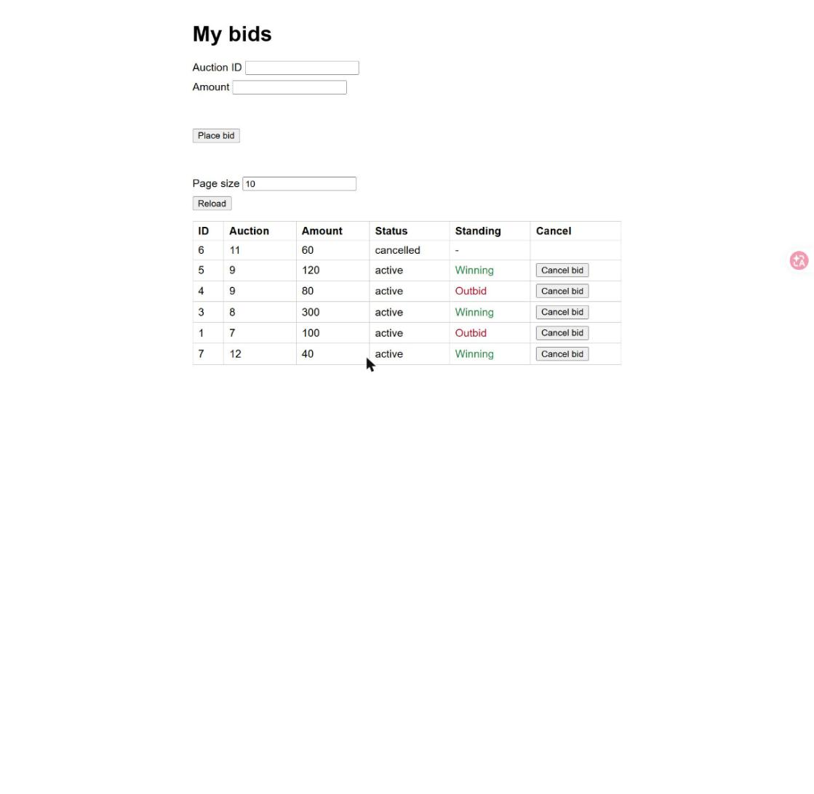
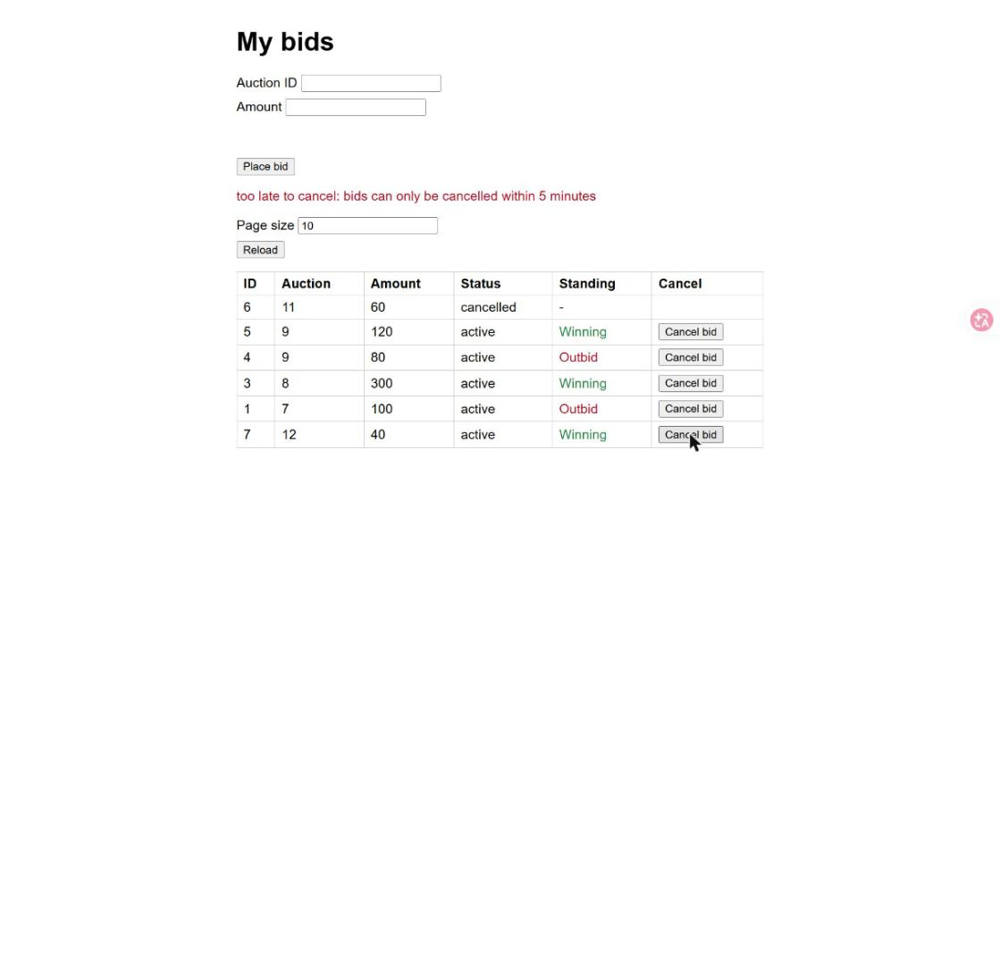
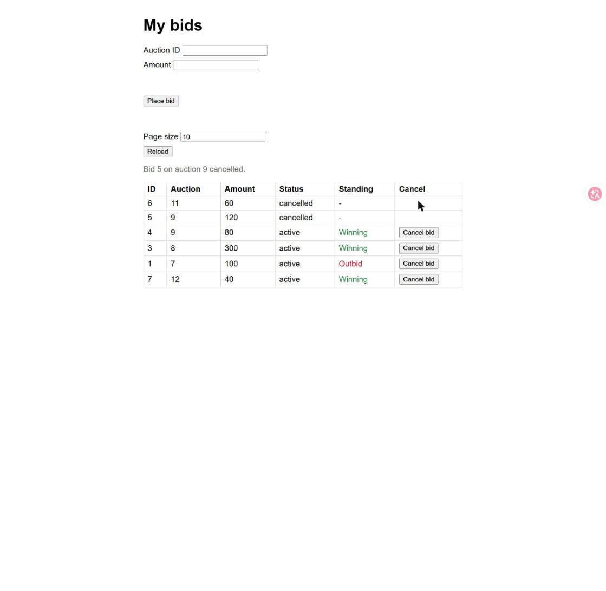

# Evidence: T-02 Limit cancels to five minutes

Captured by Claude with the Claude in Chrome tools: demo app
`python .claude/skills/evidence/seed_server.py 8010` (its bids are now one minute old when the
server starts, plus one bid placed six minutes earlier), driven in Chrome with real clicks and
screenshots saved by the tool. Nothing was collected by hand. The server was stopped and the tab
closed afterwards. No report page was published; this folder is the record.

## Steps, in order

1. Opened http://127.0.0.1:8010/, cleared localStorage, set the page size to 10 and reloaded.
2. Clicked `Cancel bid` on bid 7 (auction 12, amount 40), the bid placed six minutes earlier.
3. Clicked `Cancel bid` on bid 5 (auction 9, amount 120), placed one minute earlier.

## Screenshots

1. The demo data: every active row has a `Cancel bid` button, including bid 7, which is six
   minutes old. The button does not depend on the age of the bid.

   

2. After the click on bid 7 (dialog `Cancel bid 7 on auction 12 (amount 40)? This cannot be undone.`):
   the red line reads `too late to cancel: bids can only be cancelled within 5 minutes`, the cancel
   notice is empty, and row 7 is still `active` with its button.

   

3. After the click on bid 5: notice `Bid 5 on auction 9 cancelled.`, row 5 shows `cancelled` and `-`.
   The other bid on auction 9 (bid 4) now shows Winning; that effect is T-03's subject.

   

## Files

| File | Step | Shows | Matrix |
|---|---|---|---|
| `01-demo-data-with-an-old-bid.jpg` | Page size 10, Reload | Button on every active row, old or not | M-029 |
| `02-too-late-error.jpg` | Click `Cancel bid` on the six-minute-old bid 7 | Red `too late to cancel: ...`, row still active | M-023, M-024 |
| `03-cancel-inside-window.jpg` | Click `Cancel bid` on the one-minute-old bid 5 | Notice, row `cancelled` | M-025 (page side) |
| `tests.txt` | `run_tests.py --save` | 256 tests OK, including the T-02 tests in `test_cancel.py`, `test_cancel_api.py`, `test_cancel_page.py` | M-018 to M-029, M-059, M-060 |

## Limits

- The browser confirm dialog blocks the Chrome tools, so the run replaced `window.confirm` with a
  function that records its text and answers yes; the real dialog was not driven.
- The web UI has one fixed user (42); the bids are seeded by the script, with `created_at` relative to
  the time the server started. The run took well under five minutes, so the one-minute-old bids stayed
  inside the window; started later, the demo data would all be too late.
- The exact boundary (300000 ms accepted, 300001 ms refused) and the two simultaneous cancels are
  not shown in the browser; the unit and API tests cover them (M-018, M-019, M-026, M-060).
- No clock setting exists on the server or the API, so the browser could not show the boundary.
