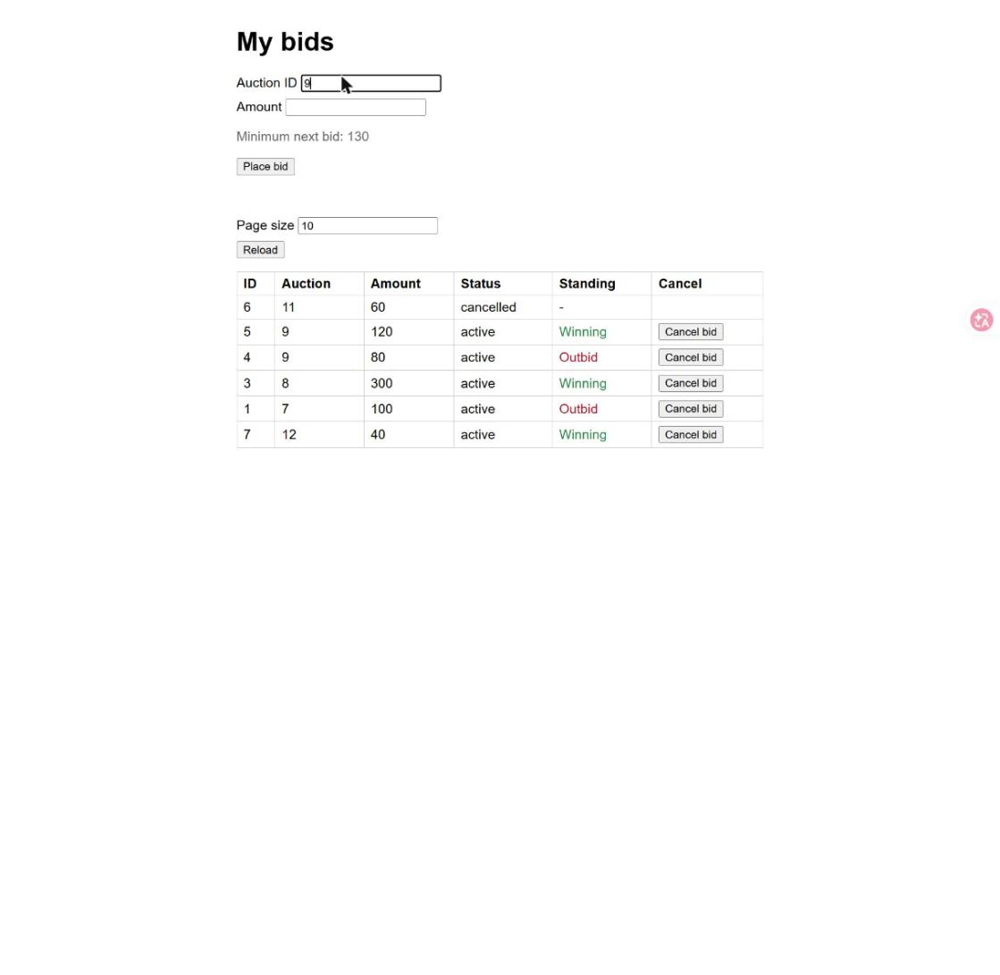
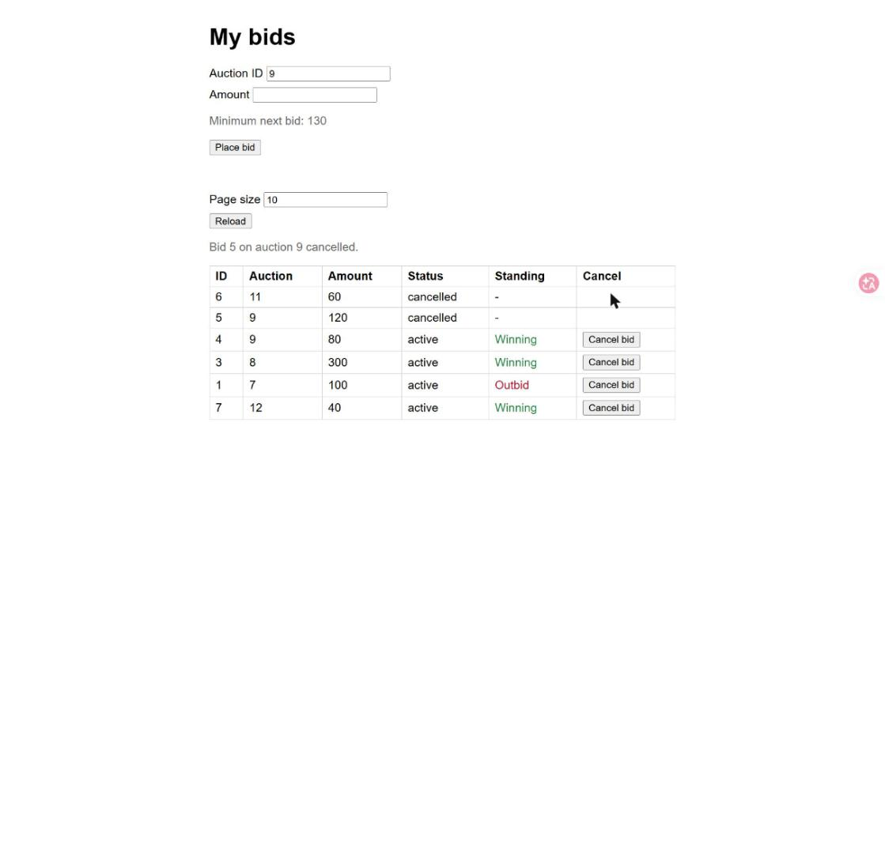
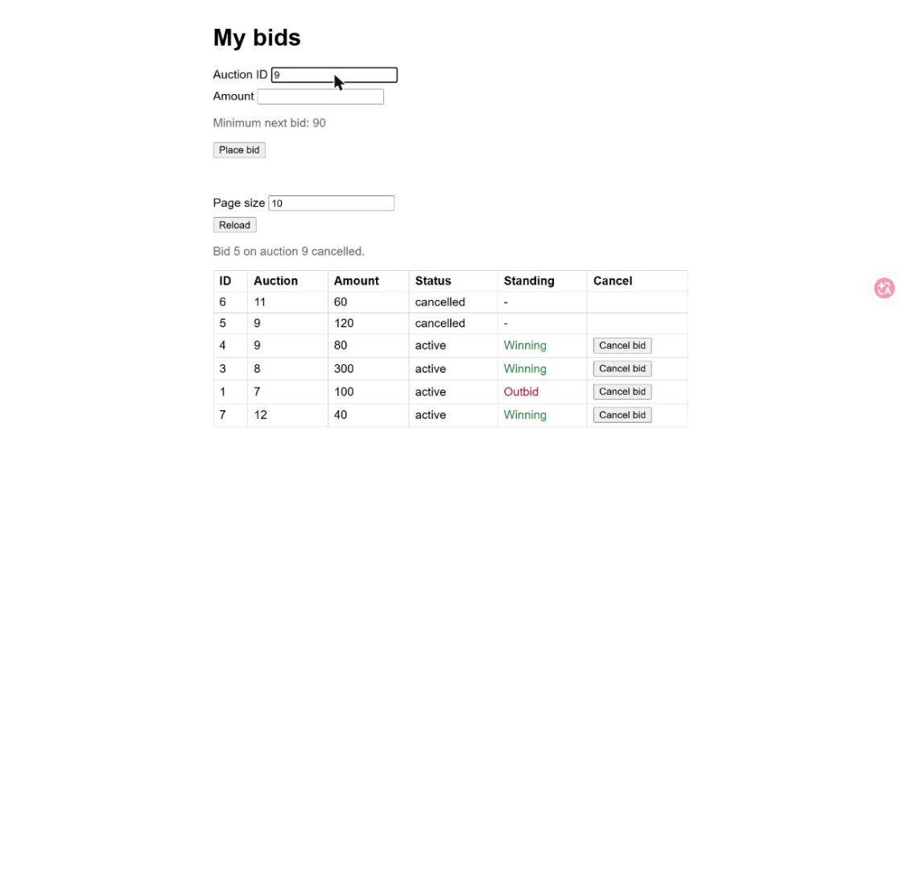

# Evidence: T-03 Recalculate the auction after a cancel

Captured by Claude with the Claude in Chrome tools: demo app
`python .claude/skills/evidence/seed_server.py 8010`, driven in Chrome with real clicks, typing and
screenshots saved by the tool. Nothing was collected by hand. The server was stopped and the tab
closed afterwards. No report page was published; this folder is the record.

T-03 changes no production code: the highest bid, the standing and the minimum next bid were already
computed from the active bids, so a cancelled bid drops out of them. The work of this ticket is the
tests (see Files) and this run.

## Steps, in order

1. Opened http://127.0.0.1:8010/, cleared localStorage, set the page size to 10 and reloaded.
2. Typed `9` in Auction ID: auction 9 has the user's bid 4 (80, Outbid) and bid 5 (120, Winning), so
   the hint reads `Minimum next bid: 130`.
3. Clicked `Cancel bid` on bid 5 (120) and accepted the dialog.
4. Selected the Auction ID field and typed `9` again to look the auction up again.

## Screenshots

1. Before the cancel: bid 5 (120) Winning, bid 4 (80) Outbid, hint `Minimum next bid: 130`.

   

2. After the cancel: notice `Bid 5 on auction 9 cancelled.`, row 5 `cancelled` and `-`, and bid 4 now
   shows Winning, as if bid 5 had never been placed. The hint still reads 130: it was fetched before
   the cancel and the page does not refresh it yet (that is T-04).

   

3. After typing the auction ID again, the lookup answers from the remaining active bid: the hint reads
   `Minimum next bid: 90` (80 plus the step of 10).

   

## Files

| File | Step | Shows | Matrix |
|---|---|---|---|
| `01-before-cancel-hint-130.jpg` | Type `9` in Auction ID | Highest 120, minimum 130 | M-030 (before) |
| `02-after-cancel-bid-4-winning.jpg` | Click `Cancel bid` on bid 5 | Bid 4 becomes Winning; the cancelled row stays in place | M-034, M-043 |
| `03-hint-after-retyping-90.jpg` | Type `9` again | Minimum 90 from the remaining bid | M-030, M-034 |
| `tests.txt` | `run_tests.py --save` | All tests OK, including the T-03 tests in `test_cancel.py` and `test_cancel_api.py` | M-030 to M-043, M-061 |

## Limits

- The browser confirm dialog blocks the Chrome tools, so the run replaced `window.confirm` with a
  function that answers yes; the real dialog was not driven.
- The web UI has one fixed user (42), and the bids are seeded by the script. Ticket S5 has user 5 post
  a bid of 1 on the freed auction; the API cannot act as user 5, so the test posts it as user 42 (M-039).
- The stale hint after a cancel (screenshot 2) is not a T-03 defect: refreshing it is T-04.
- Ties, the step thresholds at 990 and 1000, and "all bids cancelled" are not shown in the browser;
  the core and API tests cover them (M-031, M-032, M-035, M-036, M-040, M-061).
