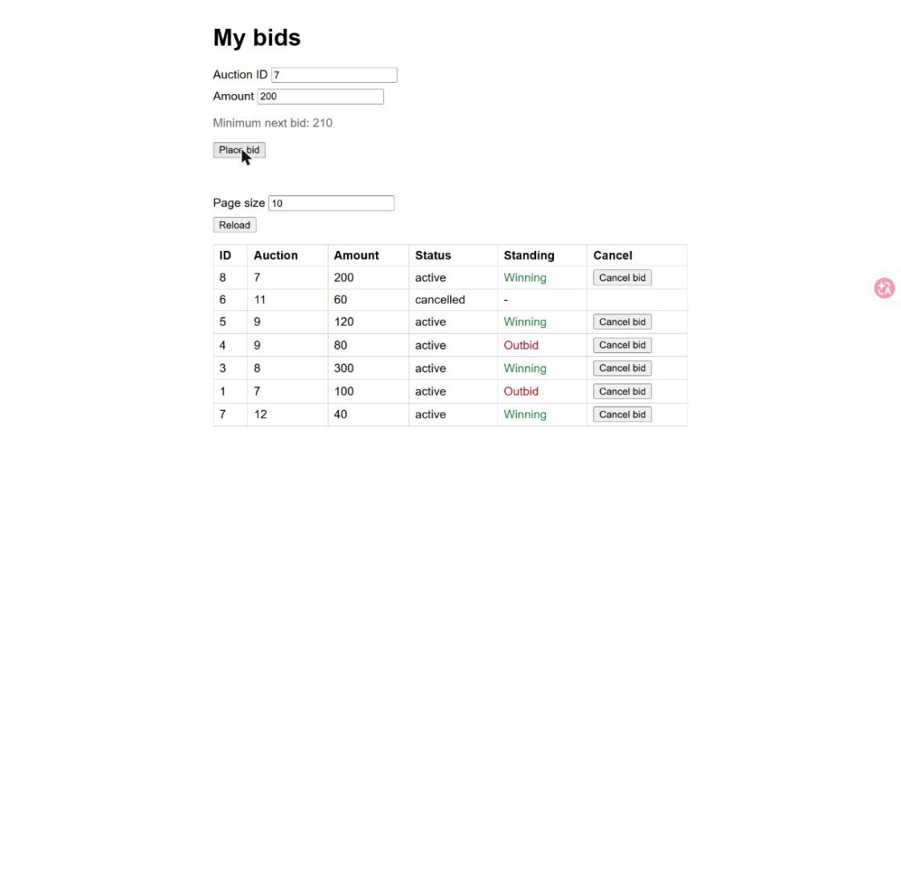
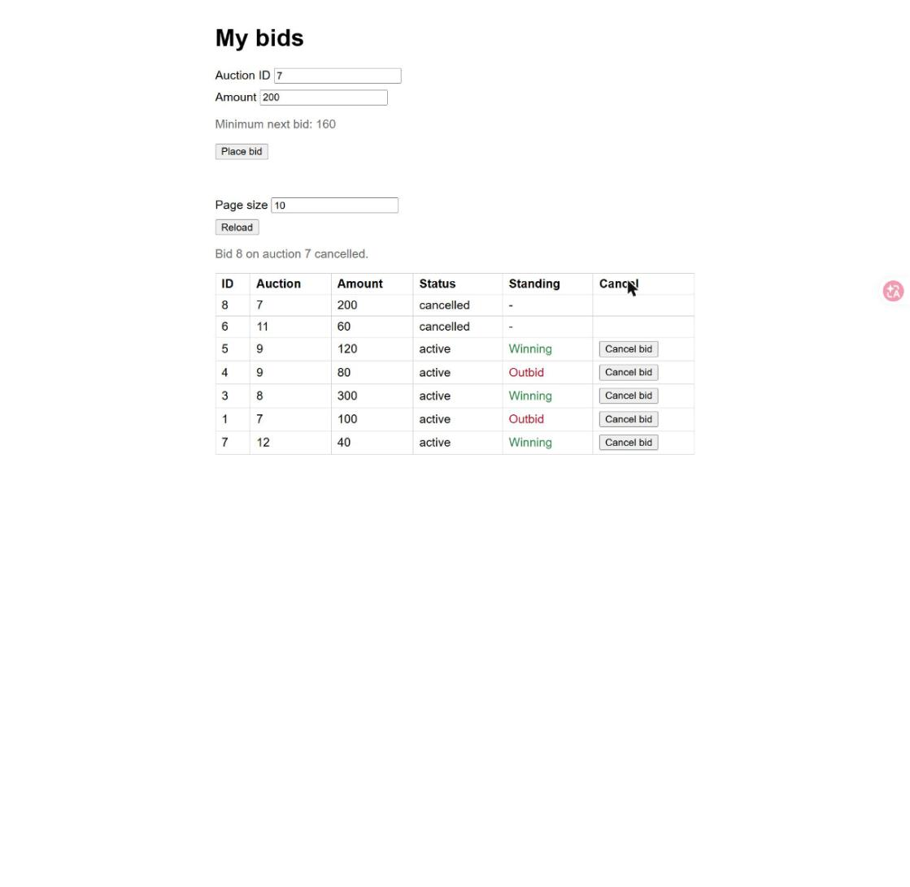
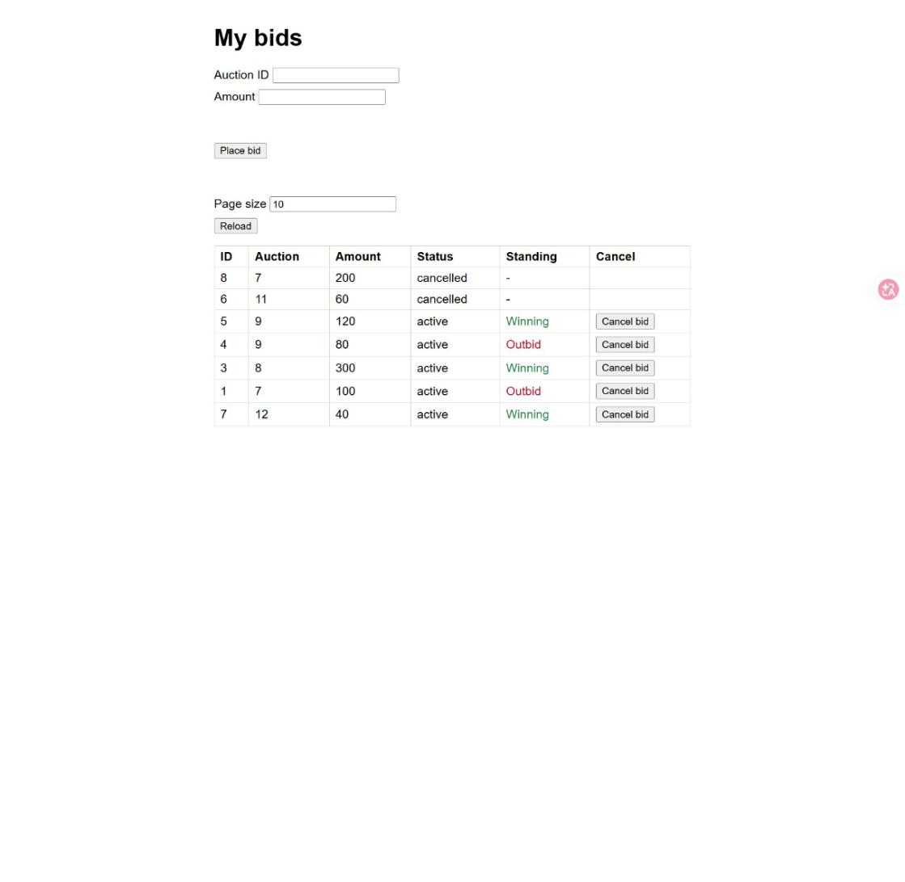

# Evidence: T-04 Keep the page in step after a cancel

Captured by Claude with the Claude in Chrome tools: demo app
`python .claude/skills/evidence/seed_server.py 8010`, driven in Chrome with real clicks, typing and
screenshots saved by the tool. Nothing was collected by hand. The server was stopped and the tab
closed afterwards. No report page was published; this folder is the record.

## Steps, in order

1. Opened http://127.0.0.1:8010/, cleared localStorage, set the page size to 10 and reloaded.
2. Typed `7` in Auction ID and `200` in Amount and pressed `Place bid`. Auction 7 already has a bid of
   150 by another user (the seed) and the user's old bid of 100, so the new bid of 200 (bid 8) becomes
   Winning and the page stores auction 7 as `winning`. The hint reads `Minimum next bid: 210`.
   (The first click on `Place bid` did not register; the second did. The screenshot of the failed
   click is not kept.)
3. Clicked `Cancel bid` on bid 8 and accepted the dialog. Without T-04 this is the case that showed
   `You were outbid on auction 7`: the stored standing was `winning`, and after the cancel the user's
   remaining bid (100) is outbid by the 150.
4. Loaded the page again in the browser and reloaded My bids.

## Screenshots

1. Before the cancel: bid 8 (200) is Winning on auction 7, the hint reads `Minimum next bid: 210`, the
   form still holds 7 and 200.

   

2. After the cancel: notice `Bid 8 on auction 7 cancelled.`, row 8 `cancelled` and `-`, **no outbid
   banner**, and the hint changed on its own from 210 to `Minimum next bid: 160` (150 plus the step of 10).
   Auction ID and Amount keep their values.

   

3. After loading the page again in the browser: still no banner, bid 8 stays `cancelled` in its place.

   

## Files

| File | Step | Shows | Matrix |
|---|---|---|---|
| `01-winning-bid-before-cancel.jpg` | Place bid 200 on auction 7 | Winning bid, hint 210 | (set-up) |
| `02-after-cancel-no-banner-hint-160.jpg` | Click `Cancel bid` on bid 8 | No banner, hint refreshed to 160, form values kept | M-045, M-048 |
| `03-after-browser-reload-no-banner.jpg` | Load the page again | No banner after the browser reload | M-048 |
| `tests.txt` | `run_tests.py --save` | All tests OK, including the T-04 page tests in `test_cancel_page.py` | M-044 to M-055, M-063 |

## Limits

- The browser confirm dialog blocks the Chrome tools, so the run replaced `window.confirm` with a
  function that answers yes; the real dialog was not driven.
- The web UI has one fixed user (42), and the bid of user 5 comes from the seed script. The real
  outbid case (S4, a bid by another user while the page was closed) was not driven in the browser; the
  Node test `test_real_outbid_still_shows_banner_after_cancel` covers it, as do the 404, 409, network
  failure, other status and failed reload cases (S5, S6), which need a server that misbehaves.
- The browser run shows the stored standing of auction 7 as `outbid` after the cancel: it was cleared
  before the reload and then written again by the reload's own check, as on any load.
- Page size 2 with "Load more" (S1) was checked only in the Node test, not in the browser.
