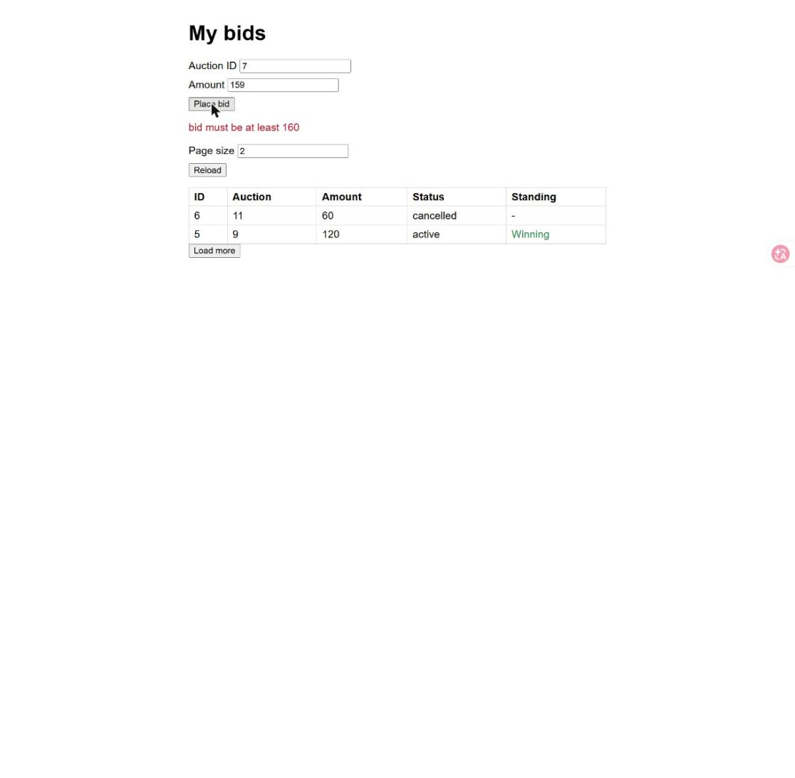
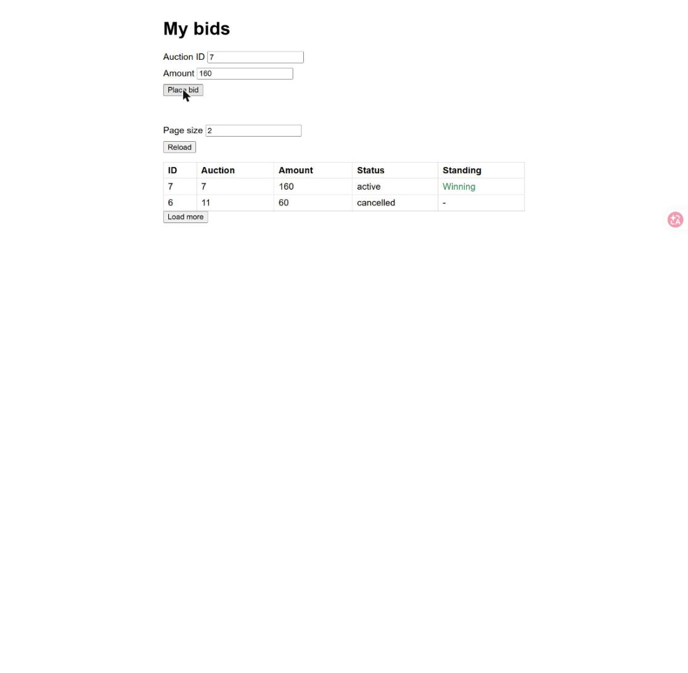

# Evidence: T-01 Reject bids below the minimum

Captured with `/evidence` steps: demo app `python .claude/skills/evidence/seed_server.py 8010`,
driven in Chrome through the Claude in Chrome tools, screenshots saved by the tool.

Report page: https://claude.ai/artifact/LQLoyWqLexK8SB1dLpm7vu (opens only for people it
is shared with). Everything on it is also in this folder.

## Screenshots

1. Amount 159 on auction 7 (highest 150): refused with "bid must be at least 160", fields kept.

   

2. Amount 160: accepted and listed as Winning, fields kept.

   

## Files

| File | Step | Shows | Matrix |
|---|---|---|---|
| `01-below-minimum-refused.jpg` | Auction 7 (highest 150 by user 5), Amount 159, Place bid | Red line "bid must be at least 160"; Auction ID 7 and Amount 159 still in the fields | M-002 (page half) |
| `02-exact-minimum-accepted.jpg` | Same form, Amount 160, Place bid | No error; row auction 7, 160, active, Winning; fields keep 7 and 160 | M-001 on the page |
| `tests.txt` | `run_tests.py --save` | 132 tests OK, including `day-11/tests/test_minimum_raise.py` (M-001 to M-012) and `day-02/tests/test_bids.py` (M-013) | all T-01 rows |

## Limits

- The web UI has one fixed user (42); the competing bid of user 5 is seeded by the script.
- Only the step of 10 was driven in the browser; the step of 50 and the tier boundaries
  are covered by the API tests.
- Screenshot 02 shows the form keeps both fields after a 201 today, so T-01 S1 ("as
  today") and T-03 S6 ("fields keep their values") agree; the note in `recall.md` is closed.
