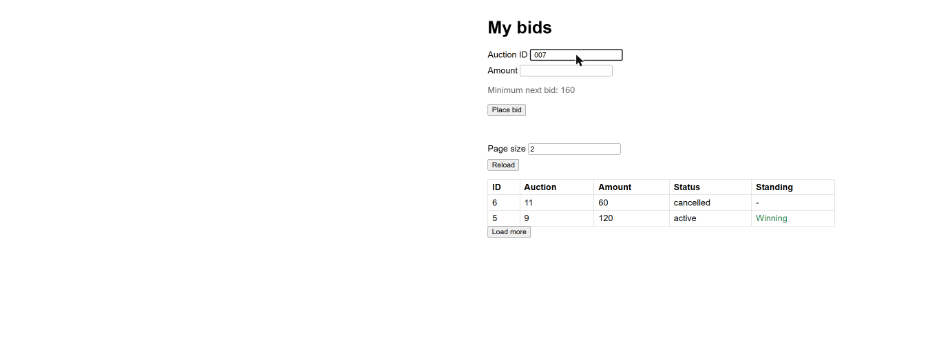
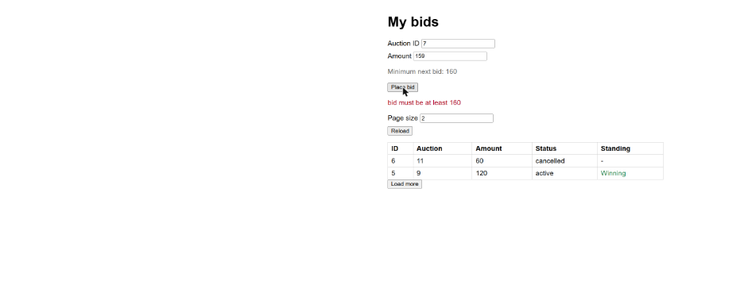
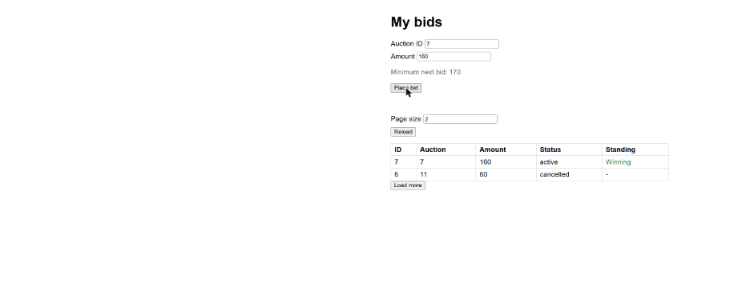
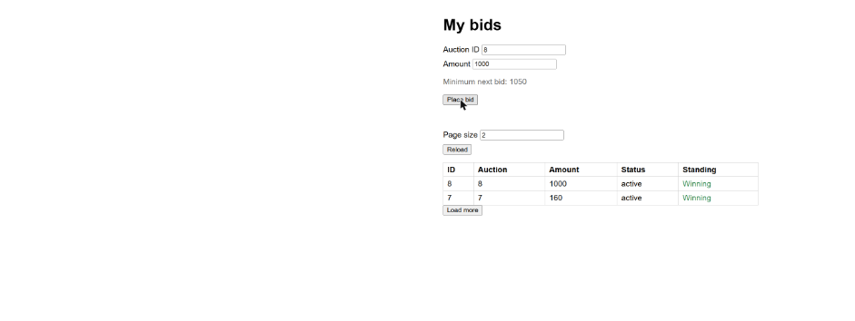

# Evidence: T-03 Show the minimum next bid

Captured with the `/evidence` steps: demo app `python .claude/skills/evidence/seed_server.py 8010`
(auction 7 highest 150 by user 5, auction 8 highest 300, auction 11 only a cancelled bid),
localStorage cleared, page driven in Chrome through the Claude in Chrome tools.

Report page: https://claude.ai/artifact/Lizh2Wf8RGbE7FZtBAr6aP (opens only for people it
is shared with). Everything on it is also in this folder.

Review: [review.md](review.md), by the `reviewer` agent after the merge (2 major, 2 minor),
with the majors reproduced on a live server.

## Screenshots

1. Type 8: "Minimum next bid: 310".

   

2. Type 11 (only a cancelled bid): "No bids yet: any amount from 1".

   

3. Type " 007 ": looked up as auction 7, "Minimum next bid: 160".

   

4. Type abc: hint empty.

   

5. Bid 159 on auction 7: "bid must be at least 160", hint refreshed, fields kept.

   

6. Bid 160 on auction 7: Winning, hint refreshed to 170.

   

7. Bid 1000 on auction 8: hint 1050, the step is 50 from 1000.

   

## Browser run

| File | Step | Shows | Matrix |
|---|---|---|---|
| `01-hint-auction-8.png` | Type 8 | "Minimum next bid: 310" under Amount, grey | M-028 |
| `02-hint-no-active-bid.png` | Type 11 (only a cancelled bid) | "No bids yet: any amount from 1" | M-029, M-035 |
| `03-hint-trimmed-007.png` | Type " 007 " | Hint for auction 7: "Minimum next bid: 160" | M-043, M-044 |
| `04-hint-empty-invalid-id.png` | Type abc | Hint empty, layout does not jump | M-030 |
| `05-rejected-bid-hint-refreshed.png` | Auction 7, Amount 159, Place bid | Red line "bid must be at least 160", hint 160, fields keep 7 and 159 | M-031 (no competing bid in between) |
| `06-accepted-bid-hint-170.png` | Amount 160, Place bid | Bid Winning, hint refreshed to "Minimum next bid: 170", fields kept | M-032 |
| `07-accepted-1000-step-50.png` | Auction 8, Amount 1000, Place bid | Hint "Minimum next bid: 1050": the step is 50 from 1000 | M-032, M-034 |

`endpoint.txt`: real responses of `GET /api/auctions/<id>/minimum-bid` from the same
server (leading zeros, query string, no active bid, 400 for `abc` and `%37`, 404 for a
trailing slash and for POST).

## Automated tests

- `t03-tests.txt`: `test_minimum_bid_endpoint.py` (12 tests, M-027, M-033 to M-038 and
  the S1/S4 paths) and `test_minimum_hint.py` (18 tests, M-028 to M-032, M-039 to M-044).
- The hint tests run the page's own `<script>` in Node (`day-11/tests/js/hint_harness.js`)
  with a fake DOM and a fake `fetch`: stale answers, failed lookups, refresh after 201,
  409, 400, 500 and network failure, the hint cleared while a refresh is in flight.
- Against the `index.html` from before T-03, all 18 hint tests fail.
- `tests.txt`: `run_tests.py --save`, 175 tests OK.

## Limits

- The hint tests need Node; without it they are skipped (the GitHub runner has Node).
- The fake DOM is not a browser: layout and colour are checked only in the screenshots.
- In the browser run no other bidder bid between the hint and the bid (one UI user), so
  "user 5 bids 120 meanwhile" (S5) is covered by the Node test, not by a screenshot.
